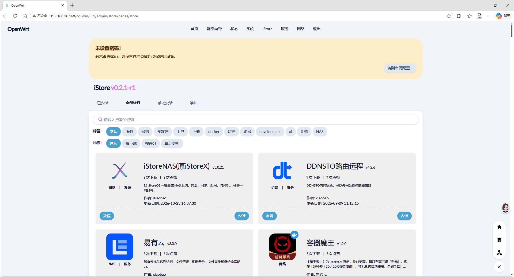
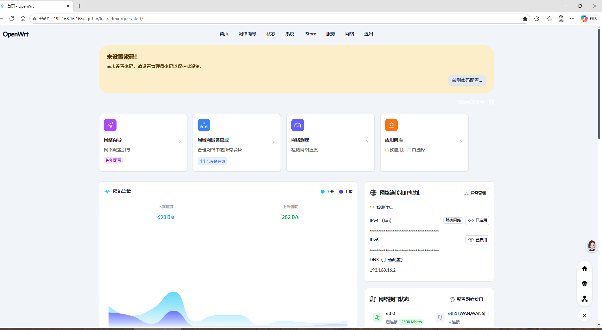

# CMCC RAX3000M（eMMC 版）刷 OpenWrt 并部署 iStoreOS 商店 / 首页 / eMMC 扩容/旁路由
## 实施技术文档

| 项目 | 内容 |
|---|---|
| 设备型号 | CMCC RAX3000M（eMMC 版，MT7981B，512MB RAM，57.6G eMMC） |
| 部署形态 | 无线桥接旁路由（DHCP 由主路由 MikroTik RB2011iL 提供） |
| 固件来源 | 第三方编译 OpenWrt 25.12.2（`DISTRIB_REVISION='by shiyu1314'`），内核 6.12.74 |
| 包管理器 | `apk`（apk-tools 3.0.5，非 opkg） |
| 最终 LAN 地址 | 192.168.16.168/24，网关/DNS 指向 192.168.16.2 |
| 最终可用空间 | /overlay = 55.7G（扩前 567MB） |
| 文档日期 | 2026-10-26 |

---

## 实际效果

**iStore 商店（全部软件）**



**iStoreOS 风格首页（Quickstart 仪表盘）**



---

## 配套文件（本仓库）

### 固件

| 文件 | 版本 | 大小 | 说明 |
|---|---|---|---|
| `firmware/openwrt-mediatek-filogic-cmcc_rax3000m-emmc-squashfs-sysupgrade.bin` | OpenWrt 25.12.2（2026.04.01，编译者 shiyu1314） | 34.8 MiB | 本方案实际使用的固件，可直接 sysupgrade 刷入 |

> 其他文件（preloader / bl31-uboot.fip / gpt.bin / initramfs-recovery.itb）请从官方源下载，见第 1 章。

### 工具

| 文件 | 用途 | 归属 |
|---|---|---|
| `tools/istore-reinstall.run` | iStore 商店安装脚本 | linkease / iStore |
| `tools/quickstart.apk` | iStoreOS 首页后端（quickstart 0.13.0） | iStoreOS |
| `tools/luci-app-quickstart.apk` | 首页 LuCI 页面（0.12.10） | iStoreOS |
| `tools/quickstart-zh.apk` | 首页中文语言包 | iStoreOS |
| `tools/alist.apk` | Alist 主程序（3.44.0，aarch64） | Alist |
| `tools/luci-alist.apk` | Alist LuCI 管理页 | iStoreOS |
| `tools/alist-zh.apk` | Alist 中文语言包 | iStoreOS |
| `tools/plink.exe` | Windows 下带密码 SSH 工具（用于 RouterOS / NAS 命令行操作） | PuTTY 项目 |

> 所有第三方组件的版权归各自作者所有，此处仅作离线备份，便于复现。工具包均已实际验证可用。

---

## 0. 前置认知（重要）

1. **iStoreOS 官方不支持 RAX3000M**。官方镜像仅覆盖 x86 与少量 ARM 机型。本方案为「OpenWrt + iStore 商店 + iStoreOS 首页组件」的等效实现，不是刷 iStoreOS 固件。
2. **本固件为 apk 体系**（OpenWrt 24.10 之后启用），所有 `opkg` 命令均不可用；社区大量旧教程（opkg install xxx.ipk）在此机器上直接失效。
3. **第三方编译固件常有源裁剪**，表现为「包找不到」而非「网络错误」，排错时先验证源清单再怀疑包名。
4. 旁路由形态下，本机不提供 DHCP，仅提供网关与 DNS；客户端需手动或由主路由 DHCP 指定网关。

---

## 1. 固件准备

### 1.1 文件清单（eMMC 版必须用 emmc 系列文件）

从 ImmortalWrt 官方源获取（也可用 OpenWrt 官方同名文件，注意目标平台 `mediatek/filogic`）：

```
https://downloads.immortalwrt.org/releases/25.12.1/targets/mediatek/filogic/
```

| 文件 | 用途 | 是否必刷 |
|---|---|---|
| `...cmcc_rax3000m-emmc-preloader.bin` | 底层引导 | 首次刷机 / 救砖 |
| `...cmcc_rax3000m-emmc-bl31-uboot.fip` | U-Boot 引导 | 首次刷机 / 救砖 |
| `...cmcc_rax3000m-emmc-gpt.bin` | GPT 分区表 | 首次刷机 / 救砖 |
| `...cmcc_rax3000m-initramfs-recovery.itb` | 临时救援系统 | 方式 B 需要 |
| `...cmcc_rax3000m-squashfs-sysupgrade.itb` | 正式系统 | 是 |

> **型号陷阱**：RAX3000M 与 RAX3000Me 是不同机型，固件不通用；eMMC 版与 NAND 版文件也不通用。刷错会变砖（可救，但需 TTL）。

### 1.2 校验

```bash
sha256sum *.itb *.bin *.fip
```

与固件选择器页面给出的 sha256 逐一比对后再刷。

---

## 2. 刷写（U-Boot 网页恢复模式）

1. 断电；用针按住 **Reset** 不放 → 插电 → 保持约 8 秒。
2. 电脑网线接路由器 **LAN 口**，网卡设静态 IP `192.168.1.2/24`，网关留空。
3. 浏览器访问 `http://192.168.1.1` → 进入 U-Boot 恢复页。
4. 上传固件：
   - **方式 A**：直接上传 `squashfs-sysupgrade.itb`。
   - **方式 B**（方式 A 失败时）：先刷 `initramfs-recovery.itb`，启动后进 LuCI（`192.168.1.1`），在「系统 → 备份与升级」刷 `squashfs-sysupgrade.itb`。
5. 等待约 3 分钟，**全程不断电**。
6. 电脑改回 DHCP，访问 `http://192.168.1.1` 进入 LuCI，立即设置 root 密码。

**救砖**：只要能进 `192.168.1.1` 恢复页即可重刷；完全无响应时需拆机接 **UART（115200 8N1）** 配合 TFTP 重刷 preloader + fip。

---

## 3. 基础配置（旁路由形态）

### 3.1 无线桥接（上游接入）

LuCI → 网络 → 无线 → 添加 → 模式 **客户端 (Client/STA)** → 连接上游 SSID；
网络 → 接口 → LAN → 物理设置：将 STA 接口与 LAN 桥接。

### 3.2 LAN 改为静态（旁路由标准姿势）

```bash
uci set network.lan.proto='static'
uci set network.lan.ipaddr='192.168.16.168'
uci set network.lan.netmask='255.255.255.0'
uci set network.lan.gateway='192.168.16.2'
uci set network.lan.dns='192.168.16.2'
uci set network.lan.peerdns='0'
uci commit network
```

### 3.3 关闭本机 DHCP（避免与主路由冲突）

```bash
uci set dhcp.lan.ignore='1'
uci commit dhcp
/etc/init.d/dnsmasq restart
```

### 3.4 验证

```bash
ip -4 addr show br-lan | grep inet        # 应为 192.168.16.168/24
nslookup www.baidu.com 192.168.16.168     # 能解析即 DNS 正常
```

> **DHCP 地址漂移坑**：若 LAN 保持 `proto=dhcp`，每次重启 IP 都会变（实测经历 .167 → .169 → .168），远程维护极易失联。旁路由必须改静态，或在主路由做 MAC-IP 绑定。

---

## 4. eMMC 扩容（核心步骤）

### 4.1 现状分析

```bash
lsblk -o NAME,SIZE,FSTYPE,LABEL,MOUNTPOINT
df -h /overlay
```

典型输出（扩容前）：

```
mmcblk0      57.6G
├─mmcblk0p6   600M squashfs  /rom
└─mmcblk0p7  56.9G ext4      /mnt/mmcblk0p7     ← 大分区闲置
/overlay     567M  13% used                      ← 系统空间极小
```

**根因**：系统 `/overlay`（可写层，装插件/存配置全在这里）指向小分区（或 loop 镜像），而 56.9G 的 p7 被闲置在 `/mnt`。

### 4.2 操作步骤

> ⚠️ 以下操作会**清空 p7 全部数据**。若 p7 内有历史数据需先备份。

```bash
# 1) 卸载并格式化 p7（label 命名 overlay，便于自动识别）
umount /mnt/mmcblk0p7
mkfs.ext4 -F -L overlay /dev/mmcblk0p7

# 2) 挂载新分区并迁移现有 overlay 数据
mkdir -p /mnt/newov
mount /dev/mmcblk0p7 /mnt/newov
tar -cf - --one-file-system -C /overlay . 2>/dev/null | tar -xf - -C /mnt/newov
sync

# 3) 记录新 UUID
blkid /dev/mmcblk0p7        # 例：UUID="26b292da-cbd3-4bc5-8730-dab391f73fe2"

# 4) 写入 fstab（持久化）
umount /mnt/newov
uci set fstab.ov=mount
uci set fstab.ov.target='/overlay'
uci set fstab.ov.uuid='26b292da-cbd3-4bc5-8730-dab391f73fe2'
uci set fstab.ov.enabled='1'
uci commit fstab

# 5) 清理旧的无用挂载条目（enabled=0 的历史残留）
uci show fstab | grep enabled        # 逐条 delete 掉指向旧 UUID 的条目

# 6) 重启生效
sync && reboot
```

### 4.3 验证

```bash
df -h /overlay
# /dev/mmcblk0p7   55.7G   18.3M   52.8G   0% /overlay   ← 成功

mount | grep p7
# /dev/mmcblk0p7 on /overlay type ext4 (rw,relatime)

block info | grep mmcblk0p7
# ... MOUNT="/overlay" ...
```

### 4.4 双保险说明

挂载生效有两条路径，建议都保留：

1. `fstab` 按 UUID 显式声明（uci 配置）
2. 分区 **label = `overlay`**，`block` 服务自动识别并挂到 `/overlay`

即使 uci 配置丢失（例如重启时机不当导致 commit 未落盘），label 仍可保证挂载成功。

> **踩坑记录**：执行「uci commit + reboot」时若 SSH 会话在 commit 落盘前被中断，会出现「挂载成功但 `uci get fstab.ov.uuid` 报 Entry not found」。原因正是 label 自动挂载生效、uci 未写入。补写 uci 即可。

---

## 5. 安装 iStore 商店（luci-app-store）

### 5.1 先修源（关键前置）

第三方固件常见问题：默认源为裁剪镜像（实测仅 913 个包）或已失效的第三方镜像（如 `mirrors.cloud.tencent.com/openwrt` 返回截断文件）。

完整可用源清单（写入 `/etc/apk/repositories.d/distfeeds.list`）：

```
https://2yy.de5.net/aarch64_cortex-a53/base/packages.adb
https://2yy.de5.net/aarch64_cortex-a53/kmod/packages.adb
https://2yy.de5.net/aarch64_cortex-a53/luci/packages.adb
https://2yy.de5.net/aarch64_cortex-a53/packages/packages.adb
https://downloads.openwrt.org/releases/25.12.2/packages/aarch64_cortex-a53/base/packages.adb
https://downloads.openwrt.org/releases/25.12.2/packages/aarch64_cortex-a53/packages/packages.adb
https://downloads.openwrt.org/releases/25.12.2/packages/aarch64_cortex-a53/luci/packages.adb
```

iStore 自身源（写入 `/etc/apk/repositories.d/customfeeds.list`）：

```
https://istore.istoreos.com/repo-apk/all/store/packages.adb
```

执行：

```bash
apk update
# 判据：应达到 9000+ distinct packages available；若只有几百个，说明源被裁剪
```

### 5.2 安装 iStore

```bash
wget -O /tmp/istore-reinstall.run \
  https://github.com/linkease/openwrt-app-actions/raw/main/applications/luci-app-systools/root/usr/share/systools/istore-reinstall.run
chmod 755 /tmp/istore-reinstall.run
/tmp/istore-reinstall.run
```

安装内容：`luci-app-store` + `taskd` + `luci-lib-taskd` + `luci-lib-xterm`。

### 5.3 常见失败与处置

| 现象 | 原因 | 处置 |
|---|---|---|
| `SSL error: 00000005` | 路由器 busybox wget 访问 GitHub TLS 失败 | 在 PC 上下载该脚本，`scp` 到 `/tmp` 后执行 |
| `coreutils / tar / script-utils (no such package)` | 源被裁剪，缺基础包 | 补官方 base/packages 源（见 5.1）后重跑 |
| 装完后菜单无 iStore | 未刷新 / rpcd 未重载 | `Ctrl+F5`；`/etc/init.d/rpcd restart` |

### 5.4 验证

```bash
apk list -I | grep -E 'luci-app-store|taskd'
# luci-app-store-0.2.1-r1 ... [installed]
netstat -tlnp | grep 80      # Web 服务在监听
```

---

## 6. 安装 iStoreOS 首页（luci-app-quickstart）

### 6.1 包位置（特殊）

该组件**不在** OpenWrt 官方源与 iStore store 源，仅存在于 iStore 的 NAS 专用目录：

| 包 | 地址 |
|---|---|
| `quickstart-0.13.0-r1.apk`（后端） | `https://istore.istoreos.com/repo-apk/aarch64_generic/nas/` |
| `luci-app-quickstart-0.12.10-r1.apk`（页面） | `https://istore.istoreos.com/repo-apk/all/nas_luci/` |
| `luci-i18n-quickstart-zh-cn-*.apk`（中文） | 同上目录 |

> 架构说明：`aarch64_generic` 的静态二进制可直接跑在 `aarch64_cortex-a53` 上。

### 6.2 依赖死锁问题与绕过

`quickstart` 声明依赖 `mdadm` → 进而依赖 `kmod-md-mod / kmod-md-raid0 / raid1 / raid10`（RAID 内核模块）。
**第三方内核固件不提供这些 kmod**，`apk add` 直接报错，无解。

绕过方案：直接用 `apk extract` 跳过依赖解析，把文件解到文件系统：

```bash
# PC 端下载（iStore CDN 直连速度快；路由器直连可达但慢）
curl -skLO https://istore.istoreos.com/repo-apk/aarch64_generic/nas/quickstart-0.13.0-r1.apk
curl -skLO "https://istore.istoreos.com/repo-apk/all/nas_luci/luci-app-quickstart-0.12.10-r1.apk"
curl -skLO "https://istore.istoreos.com/repo-apk/all/nas_luci/luci-i18n-quickstart-zh-cn-26.247.42887~c3af221.apk"

# 传到路由器
scp *.apk root@192.168.16.168:/tmp/

# 路由器上解包安装
apk extract --allow-untrusted --destination / /tmp/quickstart-0.13.0-r1.apk
apk extract --allow-untrusted --destination / /tmp/luci-app-quickstart-0.12.10-r1.apk
apk extract --allow-untrusted --destination / /tmp/luci-i18n-quickstart-zh-cn-*.apk

# 启动并设自启
/etc/init.d/quickstart enable
/etc/init.d/quickstart start
/etc/init.d/rpcd restart
```

### 6.3 `apk extract` 的怪异行为（务必知晓）

- 首次执行报 `ERROR: ... UNTRUSTED signature`，但**文件实际已解出**；
- 重复执行报 `ERROR: File exists`；
- 必须带 `--allow-untrusted` 才会继续解包；
- **判据不是返回值，而是检查落地文件**：

```bash
ls /etc/init.d/quickstart
ls /usr/libexec/quickstart/
ls /usr/share/luci/menu.d/ | grep quickstart
```

### 6.4 副作用说明

绕过包管理器安装的组件：
- 不会出现在 LuCI「软件包」列表；
- 系统升级时不会被自动更新或覆盖（重启后仍存在，因落在 /overlay）；
- 卸载需手动删除文件 + 移除 `/etc/init.d/quickstart`。

---

## 7. 最终验收清单

| 检查项 | 命令 | 期望结果 |
|---|---|---|
| 系统版本 | `cat /etc/openwrt_release` | 25.12.2 |
| 内核 | `uname -r` | 6.12.74 |
| overlay 容量 | `df -h /overlay` | 55.7G |
| 可写层实际生效 | `mount \| grep overlayfs` | upperdir 指向 /overlay |
| iStore | `apk list -I \| grep luci-app-store` | 已安装 |
| 首页服务 | `/etc/init.d/quickstart status` | running |
| LuCI 菜单 | `ls /usr/share/luci/menu.d/` | 含 `luci-app-store*` / `luci-app-quickstart.json` |
| 源健康度 | `apk update` | 9000+ 包，无 unavailable |

---

## 8. 故障排查速查

| 症状 | 定位 | 解决 |
|---|---|---|
| `apk list` 包极少（几百个） | 源被裁剪 | 按 5.1 补全 distfeeds |
| `apk update` 报 `unexpected end of file` | 镜像返回截断文件 | 换源（腾讯镜像 `mirrors.cloud.tencent.com/openwrt` 实测不可用） |
| 包名找不到但源正常 | 固件作者剔除该包 | 从 iStore repo-apk 找，或 PC 下载后 `apk extract` |
| 装完重启又消失 | 装在内存/临时目录 | 确认装在 `/`（overlay），用 `scp` + `apk add` 或 `apk extract --destination /` |
| 路由器无法访问 GitHub | 固件 TLS 栈异常 | PC 下载 → `scp` 上传（本机 IPv6 出站通常可达 GitHub API） |
| 重启后 IP 变了、SSH 失联 | LAN 为 DHCP | 改静态（见 3.2） |
| `/overlay` 仍是 567M | fstab 未生效 / label 不匹配 | 检查 `uci show fstab`，确认 UUID 与 `blkid` 一致 |

---

## 附录 A：组件来源对照表

| 组件 | 来源 | 版本 | 安装方式 |
|---|---|---|---|
| iStore 商店 | linkease `istore-reinstall.run` | luci-app-store 0.2.1 | 脚本 |
| iStoreOS 首页 | iStore repo-apk `nas_luci` + `aarch64_generic/nas` | quickstart 0.13.0 | apk extract |
| Samba | OpenWrt 源 | samba4-server 4.22.7 | apk add |
| Alist | iStore repo-apk `aarch64_generic/nas` | 3.44.0 | apk extract |
| Tailscale | pkgs.tailscale.com | 1.86.2 | 二进制 + 自写 init |
| OpenClash | GitHub vernesong/OpenClash | 0.48.002 | apk add --allow-untrusted |
| Mihomo 内核 | GitHub MetaCubeX/mihomo | v1.19.33 | 二进制至 /etc/openclash/core/clash_meta |

## 附录 B：通用经验

1. **`--allow-untrusted` 是本固件装第三方包的必要参数**（无签名密钥）。
2. **判断第三方 apk 是否安装成功，看落地文件，不看退出码**。
3. **iStore CDN（`istore.istoreos.com`）在国内速度远优于 GitHub**，同类包优先从这里取。
4. **架构映射**：`aarch64_cortex-a53` 与 `aarch64_generic` 二进制互相兼容，但 `arm`/`mips` 系列不成。
5. **旁路由上装代理/隧道类软件前**，先确认是否需要绕过隧道网段（如 Tailscale 的 `100.64.0.0/10`），否则远程通道会被代理劫持。
